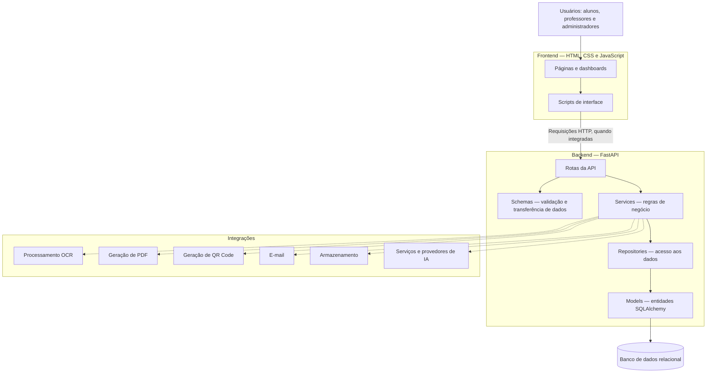

# Arquitetura do Sistema — EduGrade

## 1. Visão geral

O EduGrade é um sistema de gestão acadêmica com funcionalidades de elaboração e correção de provas, incluindo recursos de inteligência artificial.

O projeto apresenta uma arquitetura organizada em camadas, separando a interface do usuário, a API, as regras de negócio, o acesso aos dados e as integrações externas.

Este documento descreve a estrutura identificada no repositório. A presença de um módulo não garante, por si só, que todas as suas funcionalidades estejam operacionais.

## 2. Diagrama de arquitetura

**Observação:** o diagrama representa a organização lógica do projeto. As setas indicam fluxos arquiteturais esperados, e não a confirmação de que cada integração foi testada de ponta a ponta.

## 3. Frontend

O frontend está localizado na pasta `frontend/`.

Tecnologias identificadas:

- HTML
- CSS
- JavaScript

A estrutura contém páginas de autenticação, cadastro, dashboards e área de trabalho, além de interfaces específicas para alunos, professores e administradores.

Não foi identificado um arquivo `package.json` no caminho consultado. Portanto, não há evidência, nessa estrutura, de utilização de React ou de outro framework JavaScript baseado nesse arquivo.

## 4. Backend

O backend está localizado em `backend/app/` e utiliza FastAPI, conforme as dependências declaradas no projeto.

### 4.1 Rotas da API

Pasta: `backend/app/api/routes/`

Organiza os endpoints relacionados a:

- Autenticação e usuários
- Gestão acadêmica
- Solicitações de acesso
- Configurações administrativas
- Provas
- Correção com IA
- Correção em lote
- Materiais
- Auditoria

### 4.2 Serviços

Pasta: `backend/app/services/`

Contém módulos responsáveis pela implementação e organização das regras de negócio.

Entre os serviços identificados estão:

- `academic_service.py`
- `auth_service.py`
- `exam_service.py`
- `ai_correction_service.py`
- `batch_grading_service.py`
- `user_service.py`
- `material_service.py`
- `audit_service.py`

### 4.3 Repositórios

Pasta: `backend/app/repositories/`

Contém componentes de acesso e manipulação de dados, incluindo repositórios acadêmicos, de usuários, provas e correções com IA.

### 4.4 Modelos

Pasta: `backend/app/models/`

Contém os modelos SQLAlchemy que representam as entidades persistidas.

Foram identificadas 39 tabelas, detalhadas no documento `MODELO_BANCO_DE_DADOS.md`.

O diagrama de relacionamentos está disponível em `DER_EDUGRADE.md`.

### 4.5 Schemas

Pasta: `backend/app/schemas/`

Contém estruturas utilizadas para validação e organização dos dados de entrada e saída da aplicação.

### 4.6 Core

Pasta: `backend/app/core/`

Agrupa componentes centrais de configuração, conexão com banco de dados, segurança, tratamento de exceções e inicialização de dados.

## 5. Banco de dados

O projeto utiliza SQLAlchemy para mapeamento objeto-relacional e declara Alembic como dependência para gerenciamento de migrações.

A estrutura documentada contempla 39 tabelas e 79 relacionamentos identificados automaticamente.

O banco efetivamente configurado, a conectividade e a aplicação das migrações devem ser verificados no ambiente de execução.

## 6. Integrações e recursos auxiliares

A pasta `backend/app/integrations/` contém módulos relacionados a:

- OCR: `ocr/processor.py`
- PDF: `pdf/generator.py`
- QR Code: `qr/generator.py`
- E-mail: `email.py`
- Armazenamento: `storage.py`

O projeto também contém serviços de correção com IA e configuração de provedores.

As dependências declaradas incluem ferramentas como OpenCV, PyMuPDF, Pytesseract e, opcionalmente, Ollama.

A existência desses módulos e dependências não comprova, isoladamente, que todos os recursos estejam configurados e funcionando.

## 7. Testes e qualidade

O projeto declara as seguintes ferramentas:

- Pytest para testes automatizados.
- Pytest-cov para análise de cobertura.
- Ruff para análise estática.
- Black para formatação.
- Mypy para verificação de tipos.

A configuração do Pytest estabelece uma meta de cobertura mínima de 80%.

Essa meta é um requisito configurado, não um resultado de cobertura já alcançado.

## 8. Fluxo lógico de uma requisição

De maneira geral, a arquitetura foi organizada para permitir o seguinte fluxo:

1. O usuário interage com a interface.
2. O frontend envia uma requisição à API, quando a funcionalidade está integrada.
3. A rota recebe a requisição e utiliza os schemas aplicáveis.
4. A camada de serviços processa as regras de negócio.
5. Os repositórios realizam operações de persistência quando necessário.
6. O SQLAlchemy interage com o banco de dados.
7. O resultado retorna à API e pode ser apresentado ao usuário.

Esse fluxo é uma representação arquitetural geral e precisa ser confrontado com a implementação dos endpoints para validar cada funcionalidade.

## 9. Considerações técnicas

A organização do projeto demonstra uma separação estrutural entre interface, API, serviços, persistência e integrações.

Entre os pontos que ainda exigem verificação estão:

- Funcionamento da comunicação entre frontend e backend.
- Configuração e conectividade do banco de dados.
- Execução dos testes automatizados.
- Integração efetiva dos módulos de OCR e IA.
- Tratamento de erros, autenticação e permissões.
- Consistência entre os modelos, os schemas e os endpoints.

## 10. Conclusão

A arquitetura identificada fornece uma base organizada para o desenvolvimento e a manutenção do EduGrade.

A separação em camadas favorece a organização das responsabilidades e a realização de testes.

Este documento representa a arquitetura observada na estrutura do repositório, sem substituir uma validação funcional do sistema em execução.
