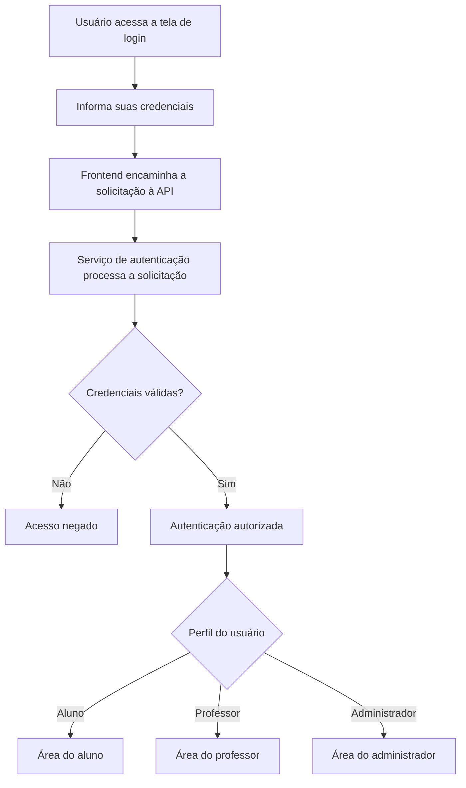
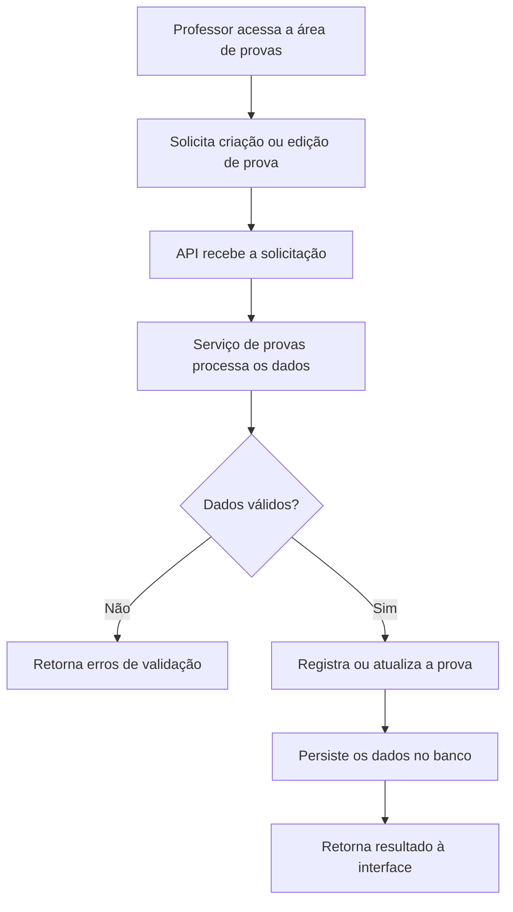
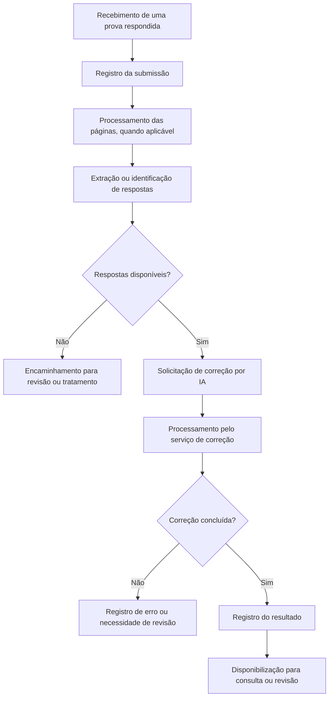
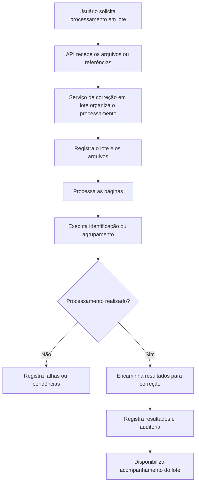

# Fluxos Principais do Sistema — EduGrade

## 1. Objetivo

Este documento apresenta os principais fluxos de funcionamento do EduGrade, um sistema de gestão acadêmica com recursos de elaboração e correção de provas.

Os diagramas foram elaborados com base na estrutura de módulos identificada no repositório.

**Importante:** os fluxos representam a organização lógica esperada do sistema. Sua execução completa depende de validação dos endpoints, serviços e integrações.

## 2. Fluxo de autenticação

O projeto contém páginas de login e cadastro, além de módulos de autenticação, segurança e gerenciamento de usuários.

### Componentes relacionados

- `frontend/login.html`
- `backend/app/api/routes/auth.py`
- `backend/app/services/auth_service.py`
- `backend/app/core/security.py`
- `backend/app/models/user.py`

### Pontos de validação

- Verificar se o frontend está integrado à rota de autenticação.
- Conferir o tratamento de credenciais inválidas.
- Validar as regras de autorização por perfil.
- Verificar o tratamento de sessões ou tokens.

## 3. Fluxo de criação e gerenciamento de provas

O projeto contém módulos dedicados ao gerenciamento de provas, questões, versões e critérios de correção.

### Componentes relacionados

- `backend/app/api/routes/exams.py`
- `backend/app/services/exam_service.py`
- `backend/app/repositories/exam_repository.py`
- `backend/app/models/exam.py`
- `backend/app/schemas/exam.py`

### Entidades relacionadas

- `exams`
- `exam_versions`
- `exam_questions`
- `answer_keys`
- `grading_rubrics`

### Pontos de validação

- Conferir as permissões para criação e edição.
- Verificar a validação dos dados da prova.
- Confirmar o tratamento das versões e questões.
- Testar as operações de persistência.

## 4. Fluxo de envio e correção de provas com IA

O backend possui módulos para submissões de provas, respostas extraídas e correções com inteligência artificial.

O fluxo abaixo representa uma sequência lógica possível para esses componentes.

### Componentes relacionados

- `backend/app/api/routes/ai_correction.py`
- `backend/app/services/ai_correction_service.py`
- `backend/app/services/configured_ai_provider.py`
- `backend/app/repositories/ai_correction_repository.py`
- `backend/app/integrations/ocr/processor.py`

### Entidades relacionadas

- `exam_submissions`
- `submission_pages`
- `extracted_answers`
- `ai_corrections`
- `correction_reviews`
- `correction_audit_logs`

### Pontos de validação

- Verificar os formatos aceitos para submissões.
- Conferir a execução e o tratamento de erros do OCR.
- Validar a configuração do provedor de IA.
- Verificar a persistência dos resultados.
- Confirmar a possibilidade de revisão humana.
- Verificar o registro de auditoria das correções.

## 5. Fluxo de correção de provas em lote

O projeto contém rotas, serviços e entidades específicas para processamento de lotes de provas.

### Componentes relacionados

- `backend/app/api/routes/batch_grading.py`
- `backend/app/services/batch_grading_service.py`
- `backend/app/models/grading_batch.py`
- `backend/app/integrations/ocr/processor.py`

### Entidades relacionadas

- `grading_batches`
- `grading_batch_files`
- `exam_submission_pages`
- `student_identification_results`
- `exam_page_groups`
- `grading_audit_logs`

### Pontos de validação

- Conferir o registro e a identificação dos lotes.
- Verificar o tratamento de arquivos inválidos.
- Validar a identificação dos alunos.
- Conferir o agrupamento das páginas.
- Verificar o registro de falhas e auditoria.
- Testar o comportamento diante de processamento parcial.

## 6. Relação com a arquitetura

Os fluxos apresentados utilizam os componentes descritos no documento `ARQUITETURA_EDUGRADE.md`.

De forma geral, a organização lógica envolve:

1. Interface do usuário.
2. Rotas da API.
3. Serviços e regras de negócio.
4. Repositórios e modelos.
5. Banco de dados.
6. Integrações externas, quando necessárias.

A sequência exata de chamadas deve ser confirmada no código de cada funcionalidade.

## 7. Considerações sobre qualidade

Para validar os fluxos, recomenda-se verificar:

- Entradas válidas e inválidas.
- Autenticação e autorização.
- Tratamento de exceções.
- Persistência e integridade dos dados.
- Respostas da API.
- Falhas em integrações externas.
- Rastreabilidade e auditoria.
- Testes automatizados disponíveis.

## 8. Conclusão

Os diagramas apresentam quatro fluxos relevantes para a arquitetura do EduGrade: autenticação, gerenciamento de provas, correção com IA e processamento em lote.

Esta documentação serve como referência técnica preliminar para entendimento e revisão do sistema.

A validação funcional deverá confirmar quais etapas estão efetivamente implementadas e operacionais.
